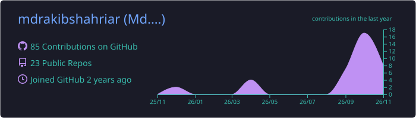
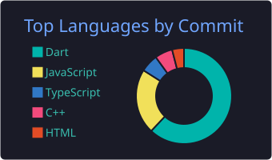
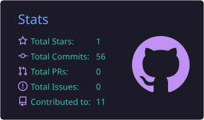
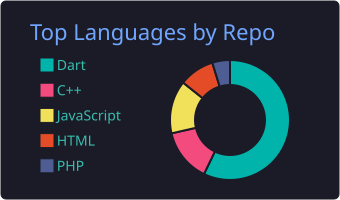

<!-- ═══════════════ HEADER ═══════════════ -->

  

  
  

  

---

##  About Me

<table>
  <tr>
    <td>

  I'm a full-stack developer who loves turning ideas into real, working products
 Currently building real-time apps with Flutter, Node.js & Firebase
 Exploring clean architecture (MVVM, Bloc) to write code that scales
 Always learning — one bug, one lesson at a time
 Open to collaborations, ideas & conversations
</td>
  </tr>
</table>

---

##  Tech Stack

<h3 align="center">Languages & Backend</h3> 
       
 <h3 align="center">Mobile & State Management</h3> 
     
 <h3 align="center">Databases</h3> 
       
 <h3 align="center">Tools & Hosting</h3> 
      

---

##  Projects

| Project | Description | Status | Deployment | Code |
|:--------|:------------|:------:|:----------:|:-----:|
|  **Chat App** | Real-time messaging with Firebase Realtime DB |  Completed |  Coming soon |
|  **Bongo Cart** | E-commerce experience |  In development |  Live soon | Backend-[Code](https://github.com/mdrakibshahriar/BongoCart_Backend) |
|  **Node.js API Backend** | REST API with Express & Firebase |  Testing |  Coming soon |

---

##  Currently Working On

-  **Real-time Chat App** using Firebase Realtime DB
-  **MVVM Architecture** in Flutter (Hive + Provider / GetX)
-  **Full-stack apps** with Node.js + Express + Firebase
-  **Clean Architecture** with Bloc

---

## GitHub Stats

  
  

  
  
  

---

##  Let's Connect

  
  
  

---

  <i>“Every bug is a lesson dressed as an error.”</i> 
  <i>“Dream big, debug patiently.”</i>

  

